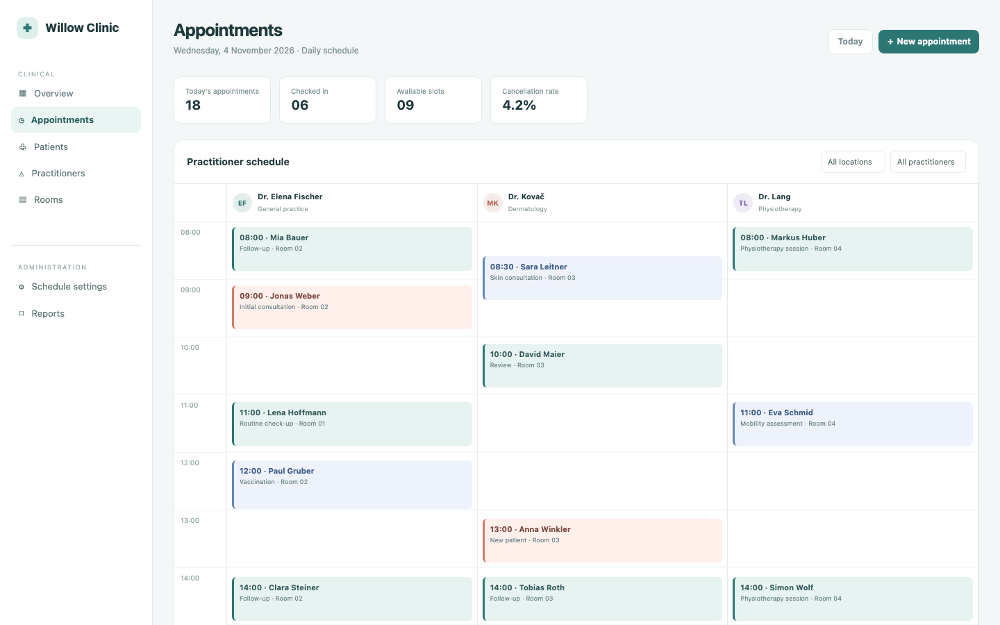

# Clinic Booking

A practitioner daybook for a small clinic: 18 appointments on 4 November 2026 across three clinicians and four rooms, location and practitioner filters, a detail panel with check-in, reschedule and create flows, plus patients, practitioners, rooms, reports and schedule settings.

## Run it

`npm install && npm start`; `npm test` runs without a port or credentials. Tests pin TZ=UTC and pass under America/Los_Angeles and Asia/Tokyo.

## What is here

- **Appointments** (`/`): the metrics, the day filters, three practitioner columns with time-positioned appointment blocks and the selected appointment panel.
- **New appointment** (`/appointments/new`) and **detail** (`/appointments/:id`): validated create, reschedule and status changes.
- **Directory** (`/patients`, `/practitioners`, `/rooms`), **Reports** (`/reports`) and **Settings** (`/settings`).

Each screen is a Cordis plugin with a `plugin.json` and a `blend.yaml` row.

## Notes

The seed is the mockup's Tuesday schedule with its patient names, times, rooms and tones, plus nine later appointments that make the headline count 18 and a month of history that gives the 4.2% cancellation rate. The mockup labels 4 November 2026 as Tuesday; the real weekday is Wednesday, so the app shows Wednesday and the difference is recorded.

## What to ask the chat next

- Check in the 10:00 David Maier appointment and open the detail panel.
- Create a 30 minute follow-up for a new patient and reschedule it.
- Filter to the West practice and compare the practitioners' loads.

## Screenshot

